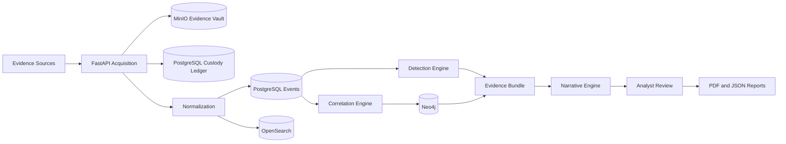

# Cybercrime Investigation Platform
  
A runnable, evidence-first starter platform for cybercrime investigations. Built as a practical MVP around **Business Email Compromise (BEC)** cases, while keeping the architecture open to ransomware, cloud compromise, malware, and network-forensics use cases.

> **Note:** This is a development scaffold, not a certified forensic product. Before using it for real legal matters, complete jurisdiction-specific legal review, forensic validation, security hardening, retention design, deployment isolation, and operational testing.

---

## ✨ Features

- Case creation with role-based API access
- Immutable-style evidence storage in MinIO
- SHA-256 evidence hashing and integrity verification
- Chain-of-custody and audit trail (PostgreSQL)
- Parsers for email, authentication logs, mailbox audits, and generic business events
- Canonical event persistence in PostgreSQL and OpenSearch
- Explainable, rule-based BEC detection engine
- Deterministic entity extraction and correlation (PostgreSQL + Neo4j)
- Evidence-grounded narrative generation
- Optional OpenAI-compatible LLM narrative mode with structured validation
- Analyst claim approval / rejection workflow
- Evidence-linked JSON and PDF report generation
- React-based analyst workspace
- Celery worker foundation for background tasks
- Sample BEC evidence + automated demo-seeding script

---

## 🏗️ Architecture



---

## 🧰 Tech Stack

| Layer | Technology |
|---|---|
| Backend | FastAPI, SQLAlchemy, Python 3.12+ |
| Frontend | React + TypeScript (Vite) |
| Database | PostgreSQL |
| Object storage | MinIO |
| Search / indexing | OpenSearch |
| Graph / correlation | Neo4j |
| Queue / cache | Redis + Celery |
| Containerization | Docker Compose |

---

## 📋 Requirements

This project runs entirely through **Docker Compose** — you do **not** need to install PostgreSQL, Redis, MinIO, OpenSearch, Neo4j, or any Python/Node packages individually.

**Required:**
- 64-bit Windows 10/11, macOS, or Linux
- Hardware virtualization enabled (BIOS/UEFI)
- [WSL 2](https://learn.microsoft.com/en-us/windows/wsl/install) (Windows only)
- [Docker Desktop](https://www.docker.com/products/docker-desktop/)
- Git
- A modern web browser

**Recommended machine specs:**

| | Minimum (demo) | Recommended (dev) |
|---|---|---|
| CPU | 4 cores | 8 cores |
| RAM | 12 GB | 16–32 GB |
| Storage | 25 GB free (SSD) | 60 GB+ free (NVMe) |

**Optional (only for development outside Docker):**
Python 3.12/3.13, Node.js 22/24 LTS, Postman/Bruno/Insomnia, DBeaver/pgAdmin, Ollama.

---

## 🚀 Quick Start

### 1. Clone the repository

```bash
git clone https://github.com/<your-username>/cybercrime-investigation-platform.git
cd cybercrime-investigation-platform
```

### 2. Configure environment variables

```bash
cp .env.example .env
```

On Windows PowerShell:

```powershell
Copy-Item .env.example .env
```

Update at least the following before starting the stack:

```
APP_SECRET_KEY
ADMIN_PASSWORD
POSTGRES_PASSWORD
MINIO_SECRET_KEY
NEO4J_PASSWORD
```

### 3. Start the platform

```bash
docker compose up -d --build
```

### 4. Open the services

| Service | URL |
|---|---|
| Analyst UI | http://localhost:5173 |
| API docs (Swagger) | http://localhost:8000/docs |
| MinIO console | http://localhost:9001 |
| Neo4j Browser | http://localhost:7474 |
| OpenSearch API | http://localhost:9200 |

Log in with the administrator credentials configured in `.env`.

### 5. Load the demo BEC case

```bash
python scripts/demo_seed.py
```

Or run it inside the backend container (no local Python needed):

```bash
docker compose exec backend python /workspace/scripts/demo_seed.py
```

Refresh the analyst UI and select **Simulated BEC Investigation**.

---

## 🔌 Main API Workflow

```
POST /api/v1/auth/login
POST /api/v1/cases
POST /api/v1/cases/{case_id}/evidence
POST /api/v1/evidence/{evidence_id}/process
POST /api/v1/cases/{case_id}/detections/run
POST /api/v1/cases/{case_id}/correlations/run
POST /api/v1/cases/{case_id}/narratives/generate
PATCH /api/v1/claims/{claim_id}/review
POST /api/v1/cases/{case_id}/reports/generate
```

---

## 📁 Repository Layout

```
cybercrime-investigation-platform/
├── backend/                 FastAPI, SQLAlchemy, parsers, analytics, reports
├── frontend/                React + TypeScript analyst workspace
├── docs/                    Architecture, installation, API, and threat model docs
├── sample-data/             Fictional BEC evidence
├── scripts/                 Bootstrap and demo automation
├── infrastructure/          Deployment notes and future manifests
├── docker-compose.yml       Complete local development stack
├── .env.example             Configuration template
└── README.md
```

---

## 📚 Documentation

- [Software & hardware requirements](docs/software-requirements.md)
- [Windows installation guide](docs/installation-windows.md)
- [Architecture](docs/architecture.md)
- [API summary](docs/api.md)
- [Threat model](docs/threat-model.md)
- [Manual development (running outside Docker)](docs/manual-development.md)
- [Validation status](docs/validation.md)

---

## 🧪 Testing

```bash
docker compose run --rm backend pytest -q
```

## 🔄 Reset local data

```bash
docker compose down -v --remove-orphans
```

This permanently deletes the local case database, evidence objects, reports, search index, and graph data.

---

## 🔒 Security Defaults & Limitations

- Raw objects use evidence IDs and content hashes to reduce accidental overwrite risk.
- OpenSearch security is disabled locally for ease of development — **never expose it publicly**.
- JWT uses a local shared secret; replace with an enterprise identity provider for production.
- MinIO, PostgreSQL, Neo4j, and Redis credentials are development defaults until changed in `.env`.
- The LLM narrative mode is disabled by default (`LLM_PROVIDER=none`). Deterministic narratives work without any external model.
- Reports are hashed but not digitally signed — add organization-controlled signing and trusted timestamps for production use.
- Database tables are auto-created for development; adopt Alembic-managed migrations before production.

---

## 🛣️ Recommended Production Work

1. Replace local JWT with OIDC + phishing-resistant MFA
2. Enable TLS and authenticated OpenSearch
3. Add tenant and jurisdiction isolation
4. Use object-lock/WORM retention on the evidence store
5. Add signed acquisition manifests and append-only remote audit storage
6. Introduce Alembic migrations, secrets management, and signed images
7. Validate parsers and reports against controlled forensic test corpora
8. Add legal-hold, privacy-right, and approved-export workflows
9. Add model, prompt, and rule governance
10. Complete penetration testing and disaster-recovery exercises

---

## 📄 License

See [LICENSE](LICENSE) for details.
